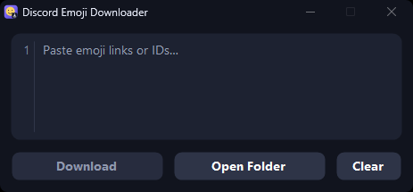

# Discord Emoji Downloader




A compact, portable Windows app for saving Discord custom emojis from links or emoji IDs.

**[Download the latest portable app](https://github.com/StriK3FoRC3/Discord-Emoji-Downloader/releases/latest)**


⚠️Disclaimer⚠️: This app was created with the help of ChatGPT/Codex. If you don't like vibe coded programs, don't use it. Please report any bugs you find, and feel free to suggest new features.
## Use

1. Download **Discord Emoji Downloader.exe** from Releases and place it in a writable folder.
2. Open the app and paste emoji links or IDs. Multiple lines, spaces, or commas are supported.
3. Click **Download**. Images appear in **Downloaded-Emojis** beside the EXE.

Use **Open Folder** to view downloads and **Clear** to empty the input.

## Features

- Animated emojis save as **GIF**; static emojis save as **WebP**.
- Downloads emojis at full size.
- Accepts Discord CDN links, numeric emoji IDs, and raw custom emoji codes.
- Skips duplicate IDs within a batch and emojis already present in the download folder.
- No installation, login, token, registry changes, or additional files needed to run.

## Requirements

Windows 10/11 with .NET Framework 4.8, an internet connection, and a writable app folder. Supported emoji hosts: `cdn.discordapp.com` and `media.discordapp.net`. Message links and stickers are not supported.

The app detects animation by inspecting an animation-capable WebP, then requests animated images as GIF and verifies multiple frames. If Discord cannot supply an animated GIF, it reports the failure rather than silently saving a still image. Failed downloads do not stop the rest of the batch. Closing during a batch requests cancellation; completed downloads are kept. Close again once it stops.

Existing images are never overwritten or removed. Deleting an emoji file lets you download it again. Previously created duplicate files are left untouched.

## Build from source

Run from the project folder:

```powershell
powershell -ExecutionPolicy Bypass -File .\build.ps1
```

The Windows .NET Framework compiler builds `build\Discord Emoji Downloader.exe`. No package installation is needed. `make-icon.ps1` creates the original smile/download icon in seven Windows icon sizes; `assets/app.ico` is embedded during compilation.

## Verification

```powershell
Start-Process '.\build\Discord Emoji Downloader.exe' -ArgumentList '--verify' -Wait
Start-Process '.\build\Discord Emoji Downloader.exe' -ArgumentList '--ui-check' -Wait
```

`--verify` checks link/ID parsing, duplicate skipping before network requests, existing and legacy filenames, actual animated GIF/static WebP data, and file saving. It requires internet access.

`--ui-check` checks smooth pixel scrolling and settling, line-number alignment, blocked horizontal scrolling, Clear, multiline paste and Undo, focus/caret, fixed window size, and rounded controls at 100–200% display scaling. It requires an interactive Windows desktop.

Reports are written beside the executable. Developer preview bitmaps may omit native rich-text contents. Build output, downloaded emojis, and local test reports are excluded from Git.
